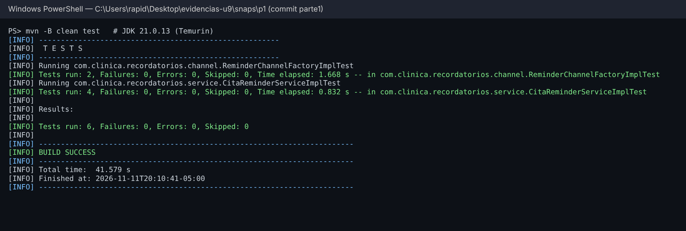
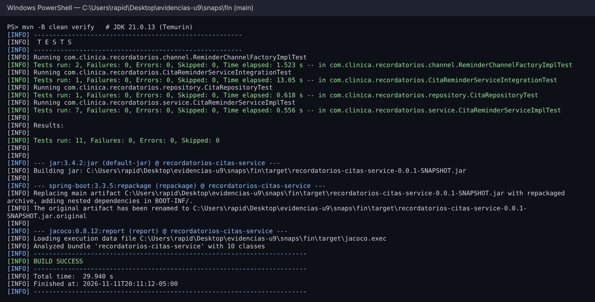
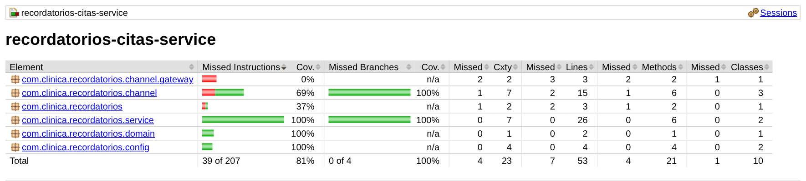

# Recordatorios Citas Service


**Estudiante:** Gustavo Ordóñez · **Curso:** Patrones de Diseño de Software, sexto semestre, Ingeniería de Sistemas UDES

## Descripción
Repositorio del post-contenido de la Unidad 9. Es un proyecto Spring Boot que revisa qué citas médicas ocurren en las próximas 24 horas y aún no tienen recordatorio, y envía el aviso por el canal preferido del paciente (correo o SMS). Desde el inicio está construido con dos patrones inyectados por constructor:

- **Strategy:** `ReminderChannel`, con las implementaciones `EmailReminderChannel` y `SmsReminderChannel`.
- **Factory Method:** `ReminderChannelFactory`, que entrega la estrategia según el canal de la cita.

```
src/main/java/com/clinica/recordatorios/
├── domain/        Cita (entidad JPA), CanalNotificacion
├── repository/    CitaRepository (JpaRepository)
├── channel/       ReminderChannel (Strategy) + Email/Sms, ReminderChannelFactory (Factory)
│   └── gateway/   NotificadorSmsGateway, TwilioNotificadorSmsGateway (simulado)
├── service/       CitaReminderService, CitaReminderServiceImpl, CitaNoEncontradaException
└── config/        ClockConfig, CanalUrgenteConfig   ← composition root: aquí viven los "new"
```

## Parte 1 — Pruebas unitarias con JUnit 5 y Mockito
`CitaReminderServiceImplTest` aísla `CitaReminderServiceImpl` de sus colaboradores, sin contexto de Spring. Se suma `ReminderChannelFactoryImplTest`, que comprueba que la fábrica entrega la estrategia correcta para cada canal.

| Prueba | Qué demuestra |
|---|---|
| `enviarRecordatoriosPendientes_citaEnVentana_usaElCanalPreferido` | Se usa el canal pedido a la fábrica, se guarda la cita y queda marcada como enviada |
| `enviarRecordatoriosPendientes_citasConCanalesDistintos_pideACadaCitaSuCanalPreferido` | Cada cita usa su propia estrategia y el mensaje lleva su fecha |
| `enviarRecordatoriosPendientes_ventanaDeterministaSegunClockFijo_consultaLosLimitesExactos` | La ventana consultada es exactamente [09:00, 09:00 del día siguiente] |
| `enviarRecordatoriosPendientes_sinCitasPendientes_noConsultaLaFactory` | Sin citas no se consulta la fábrica ni se guarda nada |

## Parte 2 — Refactor DIP, integración y CI/CD
`enviarRecordatorioUrgente` nació con un `new` hardcodeado que lo hacía imposible de probar en aislamiento (commit `feat(service): agregar enviarRecordatorioUrgente con new hardcodeado`). El refactor movió esa construcción a `config/CanalUrgenteConfig.java` e inyectó la abstracción por constructor. Luego se agregaron:

- `CitaRepositoryTest` (`@DataJpaTest`), que prueba la consulta derivada contra H2.
- `CitaReminderServiceIntegrationTest` (`@SpringBootTest`), que prueba el flujo completo con un `Clock` fijo y el gateway de SMS reemplazado por `@MockBean`.
- El pipeline `.github/workflows/ci.yml`, que ejecuta `mvn verify` con JDK 21 en cada push y pull request a `main` y publica el reporte de JaCoCo como artefacto.

## Decisiones de diseño

### Mock, Stub o Fake para cada colaborador (Parte 1)

| Colaborador | Test Double | Justificación |
|---|---|---|
| `CitaRepository` | **Mock** | No basta con programar la respuesta de `findByFechaHoraCitaBetweenAndRecordatorioEnviadoFalse`: la prueba también debe **verificar** que `save()` se llame una sola vez con la cita marcada como enviada. Si se necesita controlar la respuesta y además verificar la interacción, es un Mock y no un Stub. |
| `ReminderChannelFactory` / `ReminderChannel` | **Mock** | El comportamiento bajo prueba es la selección de la estrategia: que el servicio pida `EMAIL` cuando la cita lo prefiere y que ese canal reciba el mensaje. Eso solo se comprueba verificando interacciones, no con un valor de retorno. |
| `Clock` | **Fake** (`Clock.fixed`) | `Clock.fixed(...)` ya es una implementación real y completa del JDK. Un mock exigiría programar `instant()` y `getZone()` por separado, con el riesgo de que `LocalDateTime.now(clock)` no se comporte como un reloj real. El Fake es más simple, más legible y más fiel. |
| `NotificadorSmsGateway` (en `ReminderChannelFactoryImplTest`) | **Dummy** | Solo satisface el constructor de `SmsReminderChannel`; la fábrica nunca lo invoca. |

En `CitaRepository` el `findBy...` actúa además como Stub dentro del mismo mock: no se verifica cómo se llamó, salvo en la prueba de la ventana determinista, donde el `ArgumentCaptor` es justamente el objetivo.

### Por qué Strategy facilitó las pruebas
Sin `ReminderChannel` como interfaz, la lógica de envío (SMTP o SMS) estaría escrita dentro del servicio, y probar la selección de canal obligaría a simular librerías de bajo nivel (cliente SMTP, cliente HTTP). Con Strategy, un solo `@Mock ReminderChannel` reemplaza cualquier canal, y la prueba de canales mixtos verifica cada estrategia con una línea de `verify`.

### Por qué Factory Method facilitó las pruebas
Sin `ReminderChannelFactory`, el servicio tendría un `switch` embebido para decidir el canal, y esa decisión solo sería observable de forma indirecta (revisando qué se imprimió o qué se envió). Con la fábrica inyectada, la selección es una interacción explícita que se programa con `when(factory.obtenerCanal(EMAIL))` y se verifica con `verifyNoInteractions(factory)` cuando no hay citas. Además, la fábrica se prueba sola en `ReminderChannelFactoryImplTest`.

### El refactor DIP (Parte 2): antes y después

**Diagnóstico (antes).** La línea responsable era esta, dentro del cuerpo del método:

```java
ReminderChannel canalUrgente = new SmsReminderChannel(new TwilioNotificadorSmsGateway());
```

El método compilaba y funcionaba, pero el canal y el gateway se construían en tiempo de ejecución dentro del propio método, así que Mockito no tenía ningún punto donde insertar un Test Double. El escenario «el gateway de SMS falla, por lo tanto la cita no debe marcarse como enviada» no se podía escribir. En cambio, `enviarRecordatoriosPendientes()` sí era testeable desde la Parte 1, porque recibe la fábrica por constructor. `Mockito.mockConstruction()` habría permitido interceptar el `new`, pero eso trata el síntoma en la herramienta de pruebas y no en el diseño.

**Refactor (después).** El `new` no desaparece: se mueve al único lugar donde corresponde, el composition root.

```java
@Configuration
public class CanalUrgenteConfig {
    @Bean
    public ReminderChannel canalUrgente(NotificadorSmsGateway gateway) {
        return new SmsReminderChannel(gateway);
    }
}
```

El servicio lo recibe por constructor con `@Qualifier("canalUrgente") ReminderChannel canalUrgente`. El comportamiento externo no cambia, y `enviarRecordatorioUrgente_gatewayFalla_noMarcaComoEnviado` demuestra que la testabilidad es consecuencia directa de aplicar DIP: simula el fallo con `doThrow`, comprueba que se propaga la excepción y que `save()` nunca se llama.

### Por qué H2 real y gateway mockeado en la misma prueba
H2 es un Fake aceptable: su contrato SQL/JPA es equivalente al de una base real y no requiere infraestructura. Un proveedor de SMS no tiene un equivalente local gratuito y determinista, así que se reemplaza con `@MockBean` para no depender de credenciales, red ni disponibilidad del proveedor. Gracias a H2, el workflow de CI no necesita un bloque `services:` con PostgreSQL ni Docker.

### Ajuste respecto a la guía
En `CitaReminderServiceIntegrationTest`, el `@Bean` del reloj de prueba se llama `clockFijo()` y no `clock()`. Con el mismo nombre que el bean de `ClockConfig`, Spring Boot rechaza la sobrescritura de definiciones (`spring.main.allow-bean-definition-overriding=false` por defecto). Con otro nombre, `@Primary` hace que el reloj fijo sea el inyectado.

## Evidencias
Pruebas ejecutadas en Windows con JDK 21.0.13 (Temurin) y Maven 3.9.

**Parte 1** (commit `test(service): agregar suite unitaria…`): 6 pruebas en verde.



**Versión final**: 11 pruebas en verde (unitarias + `@DataJpaTest` + `@SpringBootTest`).



**Cobertura JaCoCo** (`target/site/jacoco/index.html`): 81 % de instrucciones, 100 % de ramas (4 de 4) y 46 de 53 líneas. El paquete `service` tiene 100 % en instrucciones y ramas. Lo no cubierto son las clases que imprimen en consola en lugar de enviar (`TwilioNotificadorSmsGateway`, `EmailReminderChannel`) y el `main` de la aplicación.



## Ejecutar las pruebas
```bash
mvn test        # Pruebas unitarias e integración (Surefire)
mvn verify      # Además genera el reporte de cobertura en target/site/jacoco/index.html
```

## Herramientas utilizadas
- Java 21, Spring Boot 3.3.5, Spring Data JPA, H2, Lombok
- JUnit 5, Mockito 5, JaCoCo 0.8.12
- Apache Maven, GitHub Actions, Git y GitHub

## Conclusiones
La testabilidad no se consiguió con la herramienta de pruebas sino con el diseño: el mismo mecanismo que permite cambiar de canal en producción (Strategy y Factory inyectados por constructor) es el que permite sustituirlos por Test Doubles en las pruebas. Elegir entre Mock, Stub y Fake dependió de qué se necesitaba verificar de cada colaborador; por eso `Clock.fixed` resultó mejor que cualquier mock. El caso de `enviarRecordatorioUrgente` mostró el contraste: con un `new` dentro del método, el escenario de fallo del gateway era imposible de probar, y bastó moverlo al composition root para que la prueba fuera trivial. Por último, usar H2 en las pruebas de integración mantuvo el pipeline de CI simple, sin servicios externos.
